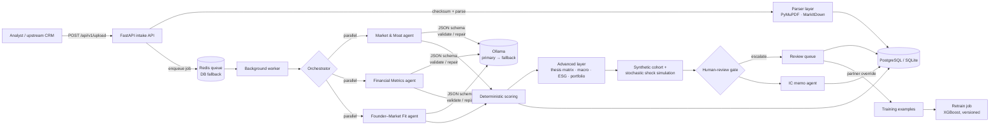

# Deal Screener

**A multi-agent system that reads a startup pitch deck and returns an explainable first-screen verdict (Yes / Maybe / Needs Review / No) plus a draft Investment Committee memo, in minutes, using local LLMs.**

[](https://github.com/Akshatb848/dealscreener/actions/workflows/ci.yml)
[](LICENSE)
[](https://www.python.org/)
[](https://fastapi.tiangolo.com/)

> Built by Akshat Banga during an internship at YourNest Venture Capital; this public version contains no YourNest data.

---

## What it does

A venture fund receives far more pitch decks than its analysts can read carefully. Deal Screener does the first pass:

1. **Takes in a pitch** (PDF, PPTX, DOCX, Markdown or text) through a REST API.
2. **Splits it into page-level chunks** and stores them, with a checksum so duplicates are caught.
3. **Runs specialist AI agents in parallel** on a local [Ollama](https://ollama.com) model. Each agent has one job:
   - **Market & Moat**: TAM/SAM/SOM, category, competition, defensibility, go-to-market
   - **Financial Metrics**: ARR, MRR, burn, runway, CAC/LTV, margins, funding ask. Amounts are normalised, so "₹5 Cr", "INR 50 lakh" and "$2M" all become numbers.
   - **Founder–Market Fit**: founders, backgrounds, prior exits, domain experience, team strength
   - **ESG & Governance**: board readiness, compliance risks, governance red flags
4. **Scores the deal with fixed rules.** The verdict comes from a transparent formula, never from LLM free text, so the same inputs always give the same answer.
5. **Stress-tests the deal** with a seeded Monte-Carlo simulation of 10 shocks (funding winter, churn spike, founder conflict and others).
6. **Drafts an IC memo** with the thesis, scorecard, risks, simulation summary and every field that is missing.
7. **Sends unclear deals to a human.** A review gate escalates low confidence, missing evidence, red flags, contradictions between agents or fragile simulation results to a review queue. Partner overrides are logged and become training examples for a retraining loop.

The AI supports the decision. A human always makes the final call.

## Architecture



**Design choices**

| Concern | Approach |
|---|---|
| LLM reliability | Every agent output is checked against a Pydantic JSON schema and repaired once if it is invalid. A primary model falls back to a local Mistral, and the system can run in a fully offline extraction mode. |
| Explainability | The verdict comes only from `scoring_logic.compute_score`. Every penalty is stored in `scoring_results`. |
| No hallucinated facts | Agents must cite chunk IDs as evidence. Anything they cannot find goes into `missing_variables` instead of being invented. |
| Throughput | Agents run in parallel in a thread pool. Long work goes through a Redis job queue to a worker, with heartbeats and recovery of orphaned jobs. If Redis is down, a database-backed queue takes over. |
| Auditability | Correlation IDs, structured JSON logs, an `audit_logs` table, and versioned scoring and simulation engines. |
| Governance | Overrides never change the AI score. They are stored next to it and feed the retraining loop. |

## How a pitch flows

```
upload ─► ingest (sha256 dedupe, parse to chunks) ─► queue ─► worker
      ─► 3 specialist agents in parallel (LLM, schema-validated)
      ─► synthesis + deterministic score ─► verdict
      ─► thesis matrix / ESG / macro ─► Monte-Carlo stress test
      ─► human-review gate ─► IC memo ─► review queue / override ─► retraining data
```

Workflow states: `pending → processing → agents_running → completed | needs_review | failed`.

## Verdict rules

```
final_score = clamp(0, 100, base_score × confidence_weight
                            − 3 × (#missing critical fields)
                            − 8 × (#red flags))
```

| Final score | Verdict |
|---|---|
| ≥ 75 | **Yes**: worth a first call |
| 50 – 74.9 | **Maybe** |
| 30 – 49.9 | **Needs Review**: an analyst should look |
| < 30 | **No** |

- `confidence_weight` is the average evidence confidence, clamped to [0.5, 1.0].
- If an agent's output fails schema validation, the deal is forced to **Needs Review**. A **No** verdict is left unchanged.
- The ESG agent, the simulation and the review gate add risk flags and review items. They do not silently change the score.

> **Illustrative defaults.** The weights and thresholds above are neutral examples chosen for this public version. They are not any fund's real investment criteria. Every value can be overridden with `SCORING_*` environment variables (see `scoring_logic.py` and `.env.example`). With the default constant base score of 70, the best result a deal can reach from extraction alone is **Maybe**. A **Yes** requires a base score of at least 75 from an upstream model, for example the retrained classifier. This is deliberate: the system is conservative by default.

## Try it in 30 seconds (no LLM, no Docker)

```bash
git clone https://github.com/Akshatb848/dealscreener.git && cd dealscreener
python -m venv .venv && source .venv/bin/activate
pip install -r requirements-dev.txt
python examples/run_demo.py
```

The demo uploads three **fictional** pitches from `examples/pitches/` through the real API. A deterministic mock stands in for the LLM (`examples/mock_llm.py`). Example output:

```
Company                            Verdict        Score  Missing  Resilience  Reviews
--------------------------------------------------------------------------------------
Acme Robotics (fictional)          Maybe           60.0        1        85.5        1
Greenleaf Pantry (fictional)       Needs Review    45.0        6        32.6        4
Nimbus Ledger (fictional)          No              27.0       12        28.4        4
```

The IC memo for each pitch is written to `examples/output/` as Markdown and JSON.

## Quick start

### Docker Compose (PostgreSQL + Redis + API + worker)

```bash
cp .env.example .env            # placeholders only; edit as needed
docker compose up --build
open http://localhost:8000/docs # interactive API explorer
```

To use a real LLM, install Ollama on the host and run `ollama pull llama3.1:8b && ollama pull mistral`. Then start the stack with `RUN_LIVE_LLM=true docker compose up`. Containers reach the host's Ollama through `host.docker.internal`.

### Local (SQLite, no Redis)

```bash
pip install -r requirements.txt
cp .env.example .env
uvicorn api_app:app --reload          # API on :8000
python worker.py                      # only needed when ASYNC_JOBS=true
```

### Screen a pitch with curl

```bash
curl -s -X POST "http://localhost:8000/api/v1/upload" \
  -F "company_name=Acme Robotics (fictional)" \
  -F "file=@examples/pitches/acme_robotics.md"
# → {"company_id": "...", "evaluation_id": "...", "status": "completed", ...}

curl -s http://localhost:8000/api/v1/evaluation/<evaluation_id> | jq '.recommendation, .deterministic_score'
curl -s http://localhost:8000/api/v1/deals/<company_id>/ic-memo | jq '.executive_summary'
```

If `ASYNC_JOBS=true`, the upload returns a `job_id`. Poll `GET /api/v1/jobs/{job_id}` until the job finishes. Set `API_KEY` in production and send it as `X-API-Key`.

### Main endpoints

| Method | Path | Purpose |
|---|---|---|
| `POST` | `/api/v1/upload` | Ingest a pitch, then evaluate it inline or queue it |
| `GET` | `/api/v1/jobs/{job_id}` | Background job status |
| `GET` | `/api/v1/evaluation/{evaluation_id}` | Full structured evaluation, with evidence |
| `GET` | `/api/v1/deals/{deal_id}` | Deal summary, verdict, simulation, risk flags |
| `GET` | `/api/v1/deals/{deal_id}/ic-memo` | Draft Investment Committee memo |
| `GET` | `/api/v1/deals/{deal_id}/simulation-runs` | Survival matrix across the 10 shock scenarios |
| `GET` | `/api/v1/review-queue` | Items escalated by the human-review gate |
| `POST` | `/api/v1/review-queue/{item_id}/override` | Partner decision. Logged, and never changes the AI score. |
| `POST` | `/api/v1/review/override` | Record an investor override, which becomes a training example |
| `GET` | `/health`, `/readiness` | Liveness, plus database, Redis and Ollama checks |

## Configuration

All settings are environment variables. See [`.env.example`](.env.example) for the full list. The ones you are most likely to change:

| Variable | Default | Meaning |
|---|---|---|
| `DATABASE_URL` | `sqlite:///./dealscreener.db` | SQLAlchemy URL (PostgreSQL in Docker) |
| `REDIS_URL` | – | Job queue. If unset, the database-backed queue is used. |
| `ASYNC_JOBS` | `false` | `true`: the upload returns a job and the worker evaluates it |
| `RUN_LIVE_LLM` | `false` | `true`: agents call Ollama. `false`: offline extraction. |
| `OLLAMA_PRIMARY_*` / `OLLAMA_FALLBACK_*` | `llama3.1:8b` / `mistral` | Primary and fallback model hosts |
| `ENABLE_ADVANCED_PIPELINE` | `true` | Thesis matrix, ESG, simulation, IC memo and review gate |
| `SIMULATION_SEED`, `SIMULATION_ITERATIONS` | `1337`, `200` | Settings for a reproducible Monte-Carlo run |
| `REVIEW_CONFIDENCE_THRESHOLD` | `0.55` | Confidence below this goes to human review |
| `SCORING_*` | see above | Scoring weights and thresholds |
| `API_KEY` | empty | If set, every `/api/v1/*` call needs `X-API-Key` |

## Tests

```bash
pip install -r requirements-dev.txt
pytest -q
```

The suite has about 110 tests and needs no Ollama, Redis or PostgreSQL. LLM calls are mocked, the Redis client is stubbed and SQLite is created per test. It covers:

- parsing, chunking and checksum dedupe
- schema validation and repair of agent output, and financial normalisation
- scoring boundaries
- the API contract and auth
- the job queue, recovery and worker heartbeat
- the simulation's reproducibility
- the review gate and the override → training example → retraining loop
- full end-to-end runs on synthetic deals (`tests/test_synthetic_deals.py`)

An optional PostgreSQL compatibility test runs when `POSTGRES_TEST_URL` is set. CI runs `ruff` plus the suite on Python 3.11 and 3.12.

## Project structure

```
api_app.py                 FastAPI app: intake, status, evaluation, deals, IC memo, review
worker.py                  Background worker (Redis BRPOP with DB-queue fallback, heartbeat)
job_queue.py, redis_client.py
ingestion_service.py       Upload validation, sha256 dedupe, chunk persistence
parser_layer.py            PDF/PPTX/DOCX/MD/TXT → page-level chunks
orchestrator_service.py    Runs the specialist agents in parallel
inference_service.py       Ollama client: retries, timeouts, primary→fallback routing
json_validation.py         Schema validation and one-shot LLM repair
agents/                    Market & moat, financial, founder–market fit, ESG, macro,
                           thesis matrix, portfolio monitoring, IC memo, human-review gate
synthesis_service.py       Merges agent outputs into the evaluation schema
scoring_logic.py           Deterministic score and verdict (illustrative defaults)
advanced_pipeline.py       Thesis matrix → simulation → review gate → IC memo
simulation/                Synthetic cohort, 10-scenario stochastic shock engine
review_service.py          Review queue and partner overrides
learning_loop.py, model_registry.py, model_loader.py, jobs/retrain_cron.py
                           Override → training data → versioned XGBoost retraining with safe fallback
models.py, db.py           SQLAlchemy models (PostgreSQL or SQLite)
examples/                  Fictional pitches, mock LLM, end-to-end demo
scripts/                   DB init, env validation, smoke tests, SQLite→Postgres migration
tests/                     pytest suite and synthetic fixtures
```

## Limitations of this public version

- **Synthetic data only.** All pitches, fixtures and companies in this repository are fictional. No real deal data, pitch decks or CRM exports are included.
- **CRM integration omitted.** The original system received deals from the fund's CRM and wrote verdicts back to it. That adapter and its configuration are removed. The generic `crm_event_service` keeps a retry-aware log that any CRM sender can plug into.
- **Illustrative scoring defaults.** The weights and thresholds are neutral placeholders, not real investment criteria.
- **No pretrained classifier.** The retraining loop trains on your own reviewed overrides. Until a model exists, the loader runs in safe deterministic mode.
- **Macro signals are unverified.** The macro-trend agent has no live market data feed, so its output is marked `unverified`.
- The advanced agents (thesis matrix, ESG, macro, portfolio) use deterministic keyword heuristics, built so they can be swapped for LLM calls.

## Author

**Akshat Banga**. [GitHub](https://github.com/Akshatb848)

Released under the [MIT License](LICENSE).
